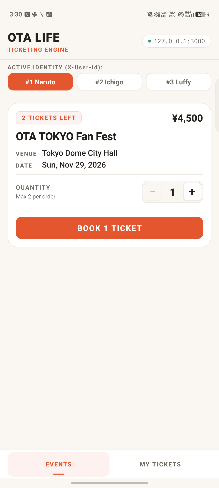
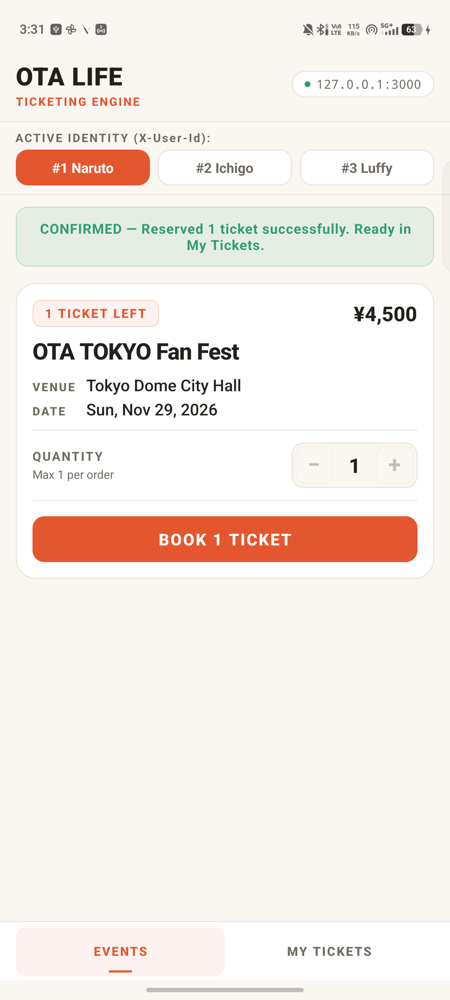
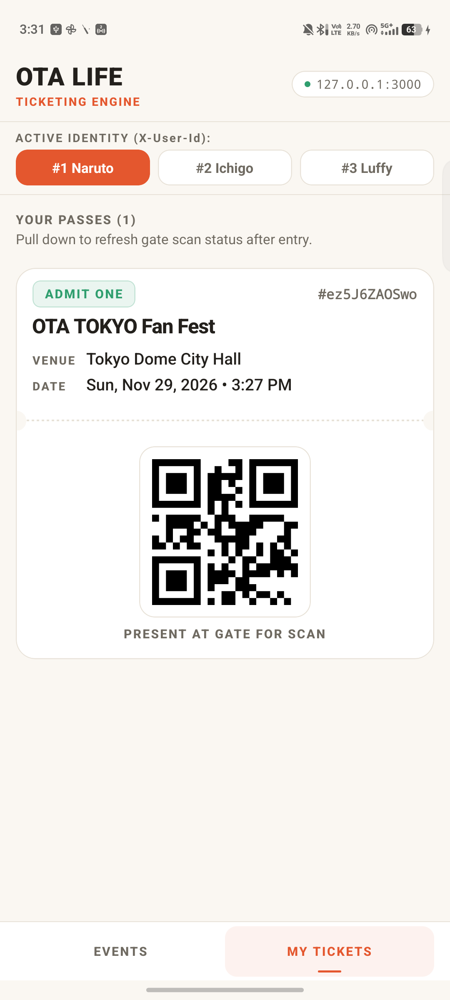
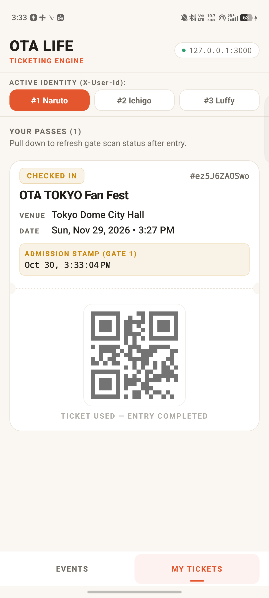
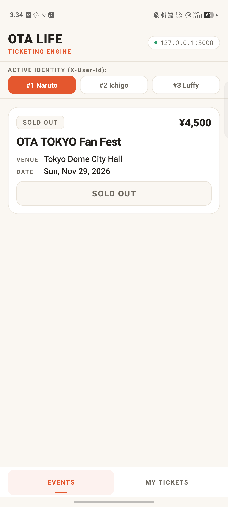
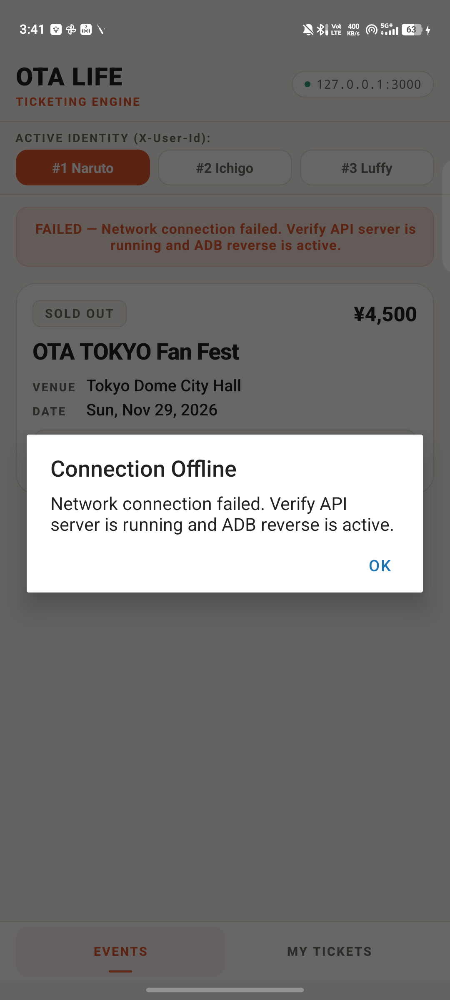

# Ota Life Mini Ticketing

> A fan can always see truthful inventory, can only book tickets that actually exist, and can only enter the venue once — even under concurrent requests.

---

## 📱 App Walkthrough & Visual Proof

| 1. Events & Stock | 2. Booking Flow & Banner | 3. Active Ticket & QR Code |
|:---:|:---:|:---:|
|  |  |  |
| **Initial State:** Naruto (`#1`), 2 tickets left, paper theme | **Micro-Optimism:** Local decrement post-201 & slide banner | **Admission:** Matcha green `ADMIT ONE` badge & quiet-zone QR |

| 4. Gate Check-in | 5. Sold Out State | 6. Offline Error Handling |
|:---:|:---:|:---:|
|  |  |  |
| **Entry Complete:** Amber `CHECKED IN` + gate scan timestamp | **Truthful Inventory:** `SOLD OUT` badge & disabled button | **Network Resilience:** Modal error dialog + status banner |

---

## 🔒 How Overselling is Prevented

Overselling is prevented via a **single conditional atomic `UPDATE` executed inside an ACID transaction**:

```sql
UPDATE `Event`
SET `ticketsLeft` = `ticketsLeft` - ?
WHERE `id` = ? AND `ticketsLeft` >= ?;
```

- **Row-Level Serialization:** The decrement and condition check run in the exact same statement under an InnoDB row-level write lock. Concurrent requests serialize at the database row.
- **Atomic Abort on Depletion:** Losing transactions evaluate against the updated stock, affect 0 rows, and abort immediately with `409 Conflict (SOLD_OUT)`.
- **Transaction Pair:** Decrementing inventory and inserting ticket records (`createMany`) commit or roll back wholly together.

### How Single Check-In is Enforced
Gate admission executes a conditional atomic update filtering on unconsumed tickets:
```sql
UPDATE `Ticket` SET `checkedInAt` = ? WHERE `code` = ? AND `checkedInAt` IS NULL;
```
- **Winner:** Affects 1 row -> returns `200 OK` with the check-in timestamp.
- **Replays:** Affect 0 rows -> queries existing record and returns `409 Conflict (ALREADY_CHECKED_IN)` with the original winner's timestamp.

---

## ⚡ Quickstart Setup

### Prerequisites
- Node.js >= 22.13 (verified with Node v24.12.0)
- MySQL Server 8.0 running locally on port `3306`
- Android phone with USB debugging enabled (or Android emulator) with Expo Go

### 1. Backend Setup
```bash
cd api
cp .env.example .env
# Set your MySQL password in .env: DATABASE_URL="mysql://root:<password>@localhost:3306/ota_life"

npm install
npx prisma migrate dev --name init
npx prisma db seed
npm run dev
```
*API runs on `http://0.0.0.0:3000`. Seed creates 1 event (`OTA TOKYO Fan Fest`, 2 tickets left) and 3 fans (`Naruto`, `Ichigo`, `Luffy`).*

### 2. Mobile App Setup (USB via ADB)
```bash
# Reverse ports so device communicates over USB (no LAN/Wi-Fi assumptions)
adb reverse tcp:8081 tcp:8081     # Metro bundler
adb reverse tcp:3000 tcp:3000     # Express API

cd app
npm install
npx expo start --clear
# Press 'a' in terminal to launch in Expo Go on device
```

---

## 📡 API Reference & cURL Examples

### 1. `GET /events` — Upcoming Events
```bash
curl -i http://localhost:3000/events
```
```json
[
  {
    "id": 1,
    "name": "OTA TOKYO Fan Fest",
    "venue": "Tokyo Dome City Hall",
    "date": "2026-11-29T07:18:49.058Z",
    "price": "4500",
    "ticketsLeft": 2
  }
]
```

### 2. `POST /events/:id/book` — Book Tickets
Header `X-User-Id` specifies fan identity (`1`, `2`, or `3`). Body `quantity` is 1 to 4.
```bash
curl -i -X POST http://localhost:3000/events/1/book \
  -H "X-User-Id: 1" \
  -H "Content-Type: application/json" \
  -d "{\"quantity\": 1}"
```
```json
{
  "tickets": [
    {
      "code": "LAupKs3-VLg",
      "createdAt": "2026-10-30T10:56:25.254Z",
      "event": {
        "id": 1,
        "name": "OTA TOKYO Fan Fest",
        "venue": "Tokyo Dome City Hall",
        "date": "2026-11-29T10:46:09.859Z"
      }
    }
  ]
}
```

### 3. `GET /me/tickets` — View My Tickets
```bash
curl -i http://localhost:3000/me/tickets -H "X-User-Id: 1"
```
```json
[
  {
    "code": "LAupKs3-VLg",
    "createdAt": "2026-10-30T10:56:25.254Z",
    "checkedInAt": null,
    "event": {
      "id": 1,
      "name": "OTA TOKYO Fan Fest",
      "venue": "Tokyo Dome City Hall",
      "date": "2026-11-29T10:46:09.859Z"
    }
  }
]
```

### 4. `POST /checkins` — Gate Admission
```bash
curl -i -X POST http://localhost:3000/checkins \
  -H "Content-Type: application/json" \
  -d "{\"code\": \"LAupKs3-VLg\"}"
```
**First Scan (200 OK):**
```json
{
  "code": "LAupKs3-VLg",
  "checkedInAt": "2026-10-30T10:56:25.304Z"
}
```
**Second Scan (409 Conflict with original timestamp):**
```json
{
  "error": {
    "code": "ALREADY_CHECKED_IN",
    "message": "Ticket has already been checked in",
    "checkedInAt": "2026-10-30T10:56:25.304Z"
  }
}
```

---

## ⚔️ Concurrency Verification

### Automated Jest Concurrency Suite
```bash
cd api
npm test
```
*Executes `Promise.allSettled` concurrent booking races on an isolated test event, asserting exactly one succeeds, one fails with `409 SoldOutError`, and `ticketsLeft` reaches 0.*

### Automated End-to-End Database Assertions
```bash
cd api
npm run verify:concurrency
```
*Runs live parallel oversell race (A1) and replay race (A4) against HTTP endpoints, printing post-attack database query assertions before resetting seed state:*
```text
=== ATTACK A1 — TWO PARALLEL OVERSELL REQUESTS (ICHIGO vs LUFFY) ===
Ichigo HTTP Result: 409 {"error":{"code":"SOLD_OUT"}}
Luffy HTTP Result:  201 {"tickets":[{"code":"X8tQ6XNX3pc", ...}]}

=== RAW DATABASE ASSERTIONS POST-ATTACK A1 ===
DB ASSERTION 1 - ticketsLeft: 0 (EXACTLY 0, NEVER -1)
DB ASSERTION 2 - total tickets created in DB: 2 (EXACTLY 2, NEVER 3)

=== ATTACK A4 — TWO PARALLEL CHECK-INS FOR TICKET 1 ===
Check-in Request A: 409 {"error":{"code":"ALREADY_CHECKED_IN","checkedInAt":"2026-10-30T10:56:25.304Z"}}
Check-in Request B: 200 {"code":"LAupKs3-VLg","checkedInAt":"2026-10-30T10:56:25.304Z"}

=== RAW DATABASE ASSERTIONS POST-ATTACK A4 ===
DB Ticket checkedInAt:                  2026-10-30T10:56:25.304Z
Winner 200 returned timestamp:          2026-10-30T10:56:25.304Z
Loser 409 returned checkedInAt:         2026-10-30T10:56:25.304Z
Byte-identical comparison (Winner/Loser): true
Byte-identical comparison (Loser/DB):    true
```

---

## 🚫 Deliberate Deferrals & Scope

- **Optional Features Deferred:** `expo-camera` scanner and `i18next` localization. The `POST /checkins` API is scanner-ready; gate check-in was verified via terminal simulation and live pull-to-refresh badge transition.
- **Idempotency Position:** Booking is atomic (cannot oversell) but retries are fresh bookings; fans reconcile via `GET /me/tickets`. To preserve trust, reads fail fast on dead networks (10s timeout), while writes (`POST /book`) await authoritative server resolution under database lock.
